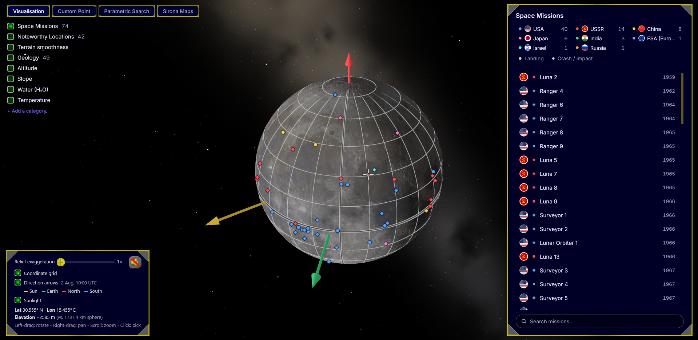
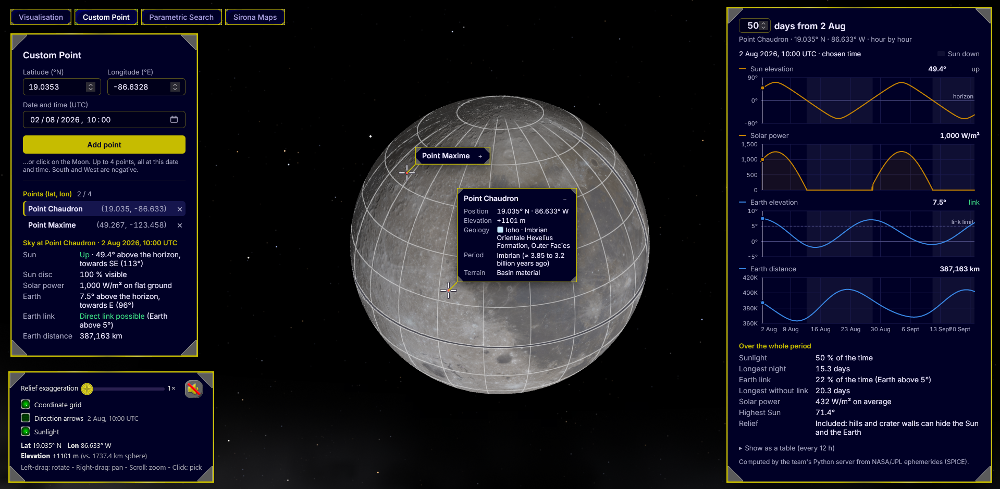
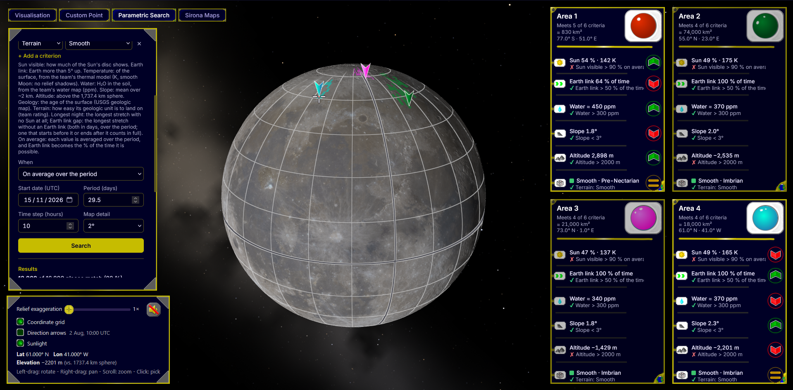
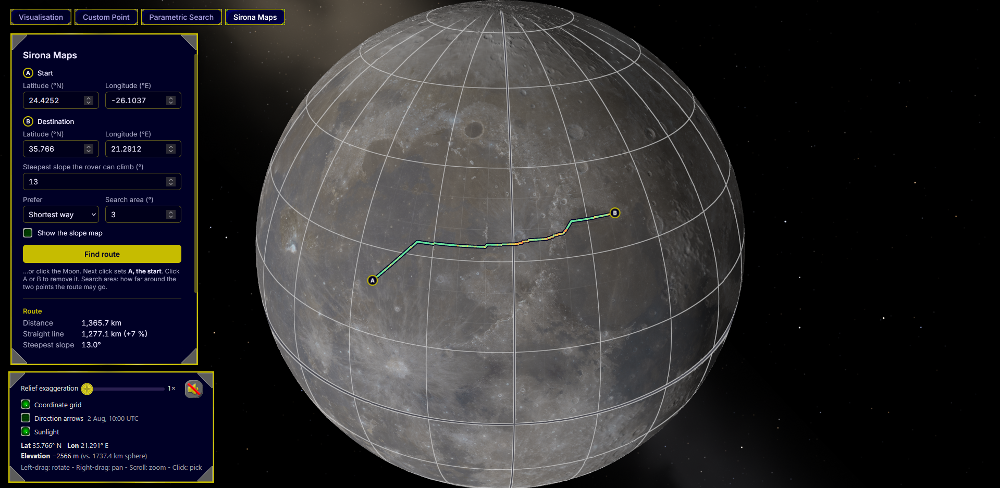

# Lunar Landing Site Navigator

NASA Space Apps Challenge 2026, Milano. A 3D Moon to find and compare landing sites: sunlight, the Earth in the sky, temperatures, slopes, water, geology, and rover routes. It aims teens, teachers, students, but also PhD students and even engineers.

## Start it

1. Get this folder: on GitHub, **Code > Download ZIP**, then extract it (Windows: right-click > Extract All).
2. Double-click **`Start Windows.bat`** (Windows) or **`Start Mac.command`** (Mac). On Linux: `python3 launcher.py`.

The app opens in the browser, at http://127.0.0.1:8000. A small window stays open in the taskbar: closing it stops the app.

The first start takes a few minutes. It installs the Python packages in a `.venv` folder (FastAPI, uvicorn, NumPy, SpiceyPy, tifffile, imagecodecs), then downloads from NASA the SPICE kernels (130 MB) and the two maps the app needs (95 MB). The 1.1 GB relief map then comes in the background, while the app already runs, and the slope map for rover routes is made from it (about a minute). If a download stops, the next start goes on with it. The next starts take a few seconds.

It needs:
- Python 3.10 or newer, 64-bit ([python.org](https://www.python.org/downloads/)). On Windows, the Start file offers to install it.
- An internet connection: for the first start, and every time for the 3D engine and the font.
- Chrome, Edge, Firefox or Safari.
- About 2.5 GB of free disk space, with all the maps.

On a Mac, if it says the file can't be opened: right-click it > Open. If it says you don't have permission: in Terminal, `chmod +x "Start Mac.command"`.

## The maps

Too big for GitHub, so the Start file gets them. If you already have them, put them in the folder, next to the Start file (a zip is fine): it moves them into place.

| File | Size | Used for | From |
|---|---|---|---|
| `lroc_color_16bit_srgb_4k.tif` | 62 MB | the Moon's colours (needed) | [NASA](https://svs.gsfc.nasa.gov/vis/a000000/a004700/a004720/lroc_color_16bit_srgb_4k.tif), at the first start |
| `ldem_16_uint.tif` | 33 MB | the Moon's relief in 3D (needed) | [NASA](https://svs.gsfc.nasa.gov/vis/a000000/a004700/a004720/ldem_16_uint.tif), at the first start |
| `ldem_64.tif` | 1.1 GB | hills hiding the Sun and the Earth | [NASA](https://svs.gsfc.nasa.gov/vis/a000000/a004700/a004720/ldem_64.tif), in the background |
| `ldem_64_slope.tif` | 870 MB | rover routes (Sirona Maps) | made from `ldem_64.tif` by `tools/make_slope_map.py`, once |

The NASA ones come from the [CGI Moon Kit](https://svs.gsfc.nasa.gov/4720/). The Start file puts the first two in `UI/tif` and the last two in `Python_backend`. Without the last two the app still works: the Moon is smooth for the Sun and Earth computations, and there are no rover routes.

The slope map is each pixel's slope in degrees, from its neighbours in `ldem_64.tif`: arctan(√((dz/dx)² + (dz/dy)²)), with dy = R × 1/64° and dx = dy × cos(latitude). By hand: `python tools/make_slope_map.py` (it needs NumPy, tifffile and imagecodecs).

## Inside

- `UI/`: the website (Three.js, no build step).
- `Python_backend/`: the server (FastAPI and SPICE). It computes the Sun, the Earth, temperatures and rover routes.
- `launcher.py`: what the Start files run.
- `tools/`: the scripts that make the slope map, the high resolution tiles and the geology data.

## The interface

The app has four modes, with their buttons at the top left. The panel at the bottom left stays in every mode: relief exaggeration, the coordinate grid, the Sun and Earth direction arrows, sunlight, music, high resolution (the 16k colour map when you zoom in), and a Help button for the mode shown. Left-drag rotates the Moon, right-drag pans, scroll zooms and a click picks a point.

### 1. Visualisation

Tick the layers to show on the Moon:
- Space Missions and Noteworthy Locations, each with a side panel, a filter, a search box and tooltips;
- Terrain smoothness, Geology, Altitude, Slope, Water (H₂O), and Temperature at a chosen date;
- "+ Add a category": any global PNG or TIFF map of the Moon, coloured on the globe.

*The 74 missions that landed or crashed on the Moon, by country, with the coordinate grid. The arrows point to the Sun (yellow), the Earth (green) and the north (red).*

*The geologic map: 49 units, coloured by period from the Copernican to the Pre-Nectarian, each with its share of the surface.*

Source: [USGS Unified Geologic Map of the Moon, 1:5,000,000](https://astrogeology.usgs.gov/search/map/unified_geologic_map_of_the_moon_1_5m_2020) (Fortezzo, Spudis & Harrel, 2020).

### 2. Custom Point

Pick up to 4 points (type a latitude and a longitude, or click the Moon) and a date. The left panel gives the sky at that time: the Sun and the Earth, how much of the Sun's disc shows, the solar power, the Earth link and the Earth's distance. The right panel follows them hour by hour for 1 to 366 days (30 by default), then sums up the period: sunlight, longest night, Earth link, longest time without a link, mean solar power. Hills and crater walls can hide the Sun and the Earth. Each point's label gives its elevation, geology and terrain.

*Two points, over 50 days from 2 August 2026. At Point Chaudron, the Sun is up half the time, the longest night lasts 15.3 days, and the Earth is high enough for a link only 22 % of the time.*

### 3. Parametric Search

Build criteria from Sun visible %, Sun elevation, Power, Temperature, Longest night, Earth elevation, Earth link, Earth link gap, Water, Slope, Altitude, Geology and Terrain. They combine with "All must hold" or "Any one is enough", and each one can hold at some point, over the whole period, on average, or on the start date. The best areas show as coloured patches with arrow markers, and each gets a panel on the right that ticks or crosses every criterion. Click two panels to compare them. "Export the areas (CSV)" saves as many areas as you want, with their values.

*Six criteria, on average over one lunar day (29.5 days from 15 November 2026). Area 1, near 77° S, meets five of them.*

### 4. Sirona Maps

Set a start A and a destination B (type them or click the Moon), and the steepest slope the rover can climb. The route avoids every steeper slope, on the 1/64° slope map (about 470 m per pixel at the equator). The search area sets how far around the two points the route may go. The result gives the distance, the straight line and the steepest slope on the way. "Show the slope map" colours the slopes on the Moon.

*A route of 1,366 km with a 13° limit, only 7 % longer than the straight line.*

## The team

- [@maximechaudronperso-ui](https://github.com/maximechaudronperso-ui) drew the UI: the mode buttons, panel frames, tick boxes, knob, area markers and music button.
- [I](https://github.com/Shashb91) made the front end: the website, the 3D Moon in Three.js and the four modes.
- [@OlivierAntonio](https://github.com/OlivierAntonio) and [@Thomas-Gaume](https://github.com/Thomas-Gaume) made the Python back end and its algorithms: the Sun, the Earth and the temperatures from NASA's SPICE ephemerides, A\* for Sirona Maps, and the referenced search with graphs for Parametric Search.
