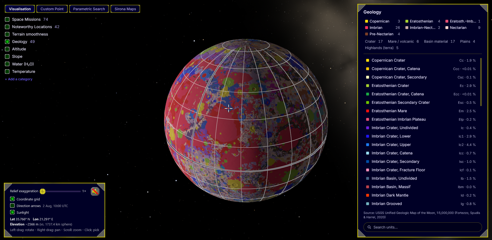

# Sirona - Lunar Landing Site Navigator

### Where on the Moon would you land? Ask the Moon.

Sunlight, the Earth in the sky, freezing nights, steep slopes, hidden water: a good landing site has to get all of them right. **Lunar Landing Site Navigator** puts them on one interactive 3D Moon, in your browser, so you can explore, search and compare places in a few clicks. Then it plans a route for a rover to go there.

Built for the **NASA Space Apps Challenge 2026 (Milano)** with real NASA and USGS data. Made for curious teens, teachers and students, and solid enough for PhD students and engineers.

## What you can do

- Fly to the Moon, and see 74 past missions, 49 geologic units, altitude, slopes, water and the temperature on any date, and even more, with the import dataset feature !
- Pick a place and a date, and see how long the Sun shines, how long the night lasts, and when the Earth is in view for a radio link.
- Tell the app what your mission needs ("more sunlight, Earth always in sight, gentle slope") and it shows you the best areas on the Moon. Compare two of them side by side, and save them all in a spreadsheet.
- Choose a start, a destination and the steepest slope your rover can climb. The app draws the route, avoiding anything steeper.

## Try it in two clicks

1. On this page, click **Code > Download ZIP**, then extract it (Windows: right-click > Extract All).
2. Double-click **`Start Windows.bat`** (Windows) or **`Start Mac.command`** (Mac). On Linux: `python3 launcher.py`.

That's all. The app sets itself up, downloads the NASA data it needs and opens in your browser. The first start takes a few minutes; after that it opens in seconds. Keep the small window open while you use the app: closing it stops the app.

At the first start, the window asks one question: **Download the high quality map? (y/n)**. Answer `y` for the most precise results (a 1.1 GB relief map, downloaded while the app already runs), or `n` to use the standard map, which is already there. Your answer is saved in `map_quality.txt`: delete that file to be asked again.

You need [Python](https://www.python.org/downloads/) (3.10 or newer, 64-bit; on Windows the Start file offers to install it), an internet connection, a recent browser, and about 2.5 GB of free disk space with the high quality map (600 MB without).

On a Mac, if it says the file can't be opened: right-click it > Open. If it says you don't have permission, run `chmod +x "Start Mac.command"` in Terminal.

## The four modes

The buttons are at the top left. Left-drag rotates the Moon, right-drag pans, scroll zooms and a click picks a point. The bottom-left panel stays with you in every mode (relief exaggeration, grid, Sun and Earth arrows, sunlight, music, high resolution), and a **Help** button explains the mode you're in.

### 1. Visualisation: see the Moon

Switch layers on and off: space missions, noteworthy locations, geology, altitude, slope, water, terrain smoothness and temperature. You can even add your own map of the Moon.

*The geologic map: 49 units, coloured by period, each with its share of the surface.*

### 2. Custom Point: live there for a month

Pick up to 4 points and a date. See the Sun and the Earth in the sky of each point, hour by hour for 1 to 366 days (30 by default), with the sunlight, the longest night, the Earth link and the solar power. Hills and crater walls that hide the Sun are taken into account.

*Two points over 50 days. At Point Chaudron the Sun is up half the time, and the longest night lasts 15.3 days.*

### 3. Parametric Search: describe it, we find it

Combine criteria (sunlight, temperature, nights, Earth link, water, slope, altitude, geology and more), choose "all must hold" or "any one is enough", and the best areas light up on the Moon. Each has its own panel that ticks or crosses every criterion. Click two to compare, and export as many as you want to a CSV file.

*Six criteria, on average over one lunar day. Area 1, near 77° S, meets five of them.*

### 4. Sirona Maps: drive there

Set A, B and the steepest slope your rover can take. The app finds a route that avoids every steeper slope, then tells you the distance, how it compares with a straight line and the steepest slope on the way.

*A route of 1,366 km with a 13° limit, only 7 % longer than the straight line.*

## The team

- [@maximechaudronperso-ui](https://github.com/maximechaudronperso-ui) drew the interface: the mode buttons, panel frames, tick boxes, knob, area markers and music button, but also with gathering the datasets.
- [@Shashb91](https://github.com/Shashb91) built the website, with the help of Claude AI by Anthropic : the 3D Moon in Three.js and the four modes, but also with gathering the datasets.
- [@OlivierAntonio](https://github.com/OlivierAntonio) and [@Thomas-Gaume](https://github.com/Thomas-Gaume) built the Python brain behind it: the Sun, the Earth and the temperatures from NASA's SPICE data, the A\* route finder for Sirona Maps, and the search for Parametric Search.

## Under the hood

The data, the maps and the folders

**Data.** [NASA's CGI Moon Kit](https://svs.gsfc.nasa.gov/4720/) (LRO colour and elevation maps), NASA NAIF SPICE kernels, the [USGS Unified Geologic Map of the Moon](https://astrogeology.usgs.gov/search/map/unified_geologic_map_of_the_moon_1_5m_2020) (Fortezzo, Spudis & Harrel, 2020), and the thermal model of Hayne et al. (2017) for temperatures.

**The maps.** They are too big for GitHub, so the Start file downloads them from NASA at the first start (SPICE kernels 130 MB, two maps 95 MB). If you answer `y` to the map question, the 1.1 GB high quality relief map comes in the background while the app already runs, and the slope map for rover routes is made from it (about a minute). If you answer `n`, the server uses the standard relief map of the 3D globe instead (16 pixels per degree, about 1.9 km, against 64 and about 470 m): the Start file converts it to kilometres and makes its slope map, in a few seconds. If a download stops, the next start goes on with it. If you already have the files, put them next to the Start file (a zip is fine) and it moves them into place.

| File | Size | Used for | From |
|---|---|---|---|
| `lroc_color_16bit_srgb_4k.tif` | 62 MB | the Moon's colours (needed) | [NASA](https://svs.gsfc.nasa.gov/vis/a000000/a004700/a004720/lroc_color_16bit_srgb_4k.tif) |
| `ldem_16_uint.tif` | 33 MB | the Moon's relief in 3D (needed) | [NASA](https://svs.gsfc.nasa.gov/vis/a000000/a004700/a004720/ldem_16_uint.tif) |
| `ldem_64.tif` | 1.1 GB | hills hiding the Sun and the Earth | [NASA](https://svs.gsfc.nasa.gov/vis/a000000/a004700/a004720/ldem_64.tif) |
| `ldem_64_slope.tif` | 870 MB | rover routes (Sirona Maps) | made from `ldem_64.tif` by `tools/make_slope_map.py` |
| `ldem_16.tif` | 47 MB | hills, with the standard map | made from `ldem_16_uint.tif` (km = value × 0.0005 − 10) |
| `ldem_16_slope.tif` | 55 MB | rover routes, with the standard map | made from `ldem_16.tif` by `tools/make_slope_map.py` |

The high quality maps are `ldem_64.tif` and `ldem_64_slope.tif`; the standard ones are the last two.

**The slope map** is each pixel's slope in degrees, from its neighbours in `ldem_64.tif`: arctan(√((dz/dx)² + (dz/dy)²)), with dy = R × 1/64° and dx = dy × cos(latitude) (1/16° for the standard map). By hand: `python tools/make_slope_map.py`.

**The folders.**
- `UI/`: the website (Three.js, no build step).
- `Python_backend/`: the server (FastAPI and SPICE).
- `launcher.py`: what the Start files run. It installs the Python packages in a `.venv` folder, downloads the data and starts the app.
- `tools/`: the scripts that make the slope map, the high resolution tiles and the geology data.

